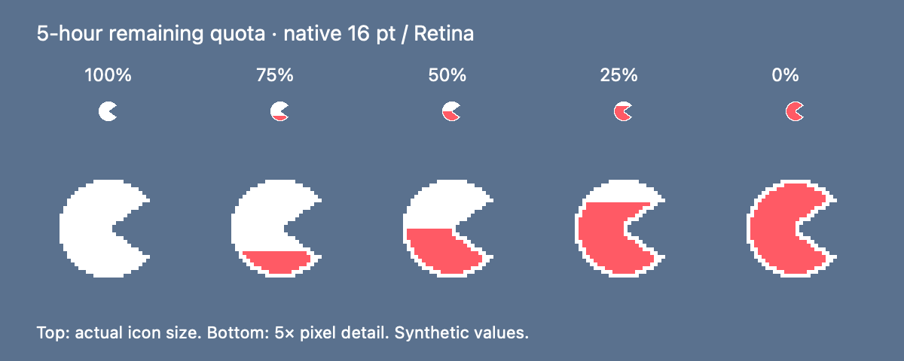

# Codex Pac-Man

**A tiny SwiftBar plugin that tracks your Codex limits — and eats them.**

A Pac-Man-shaped 5-hour quota meter stays quietly in your menu bar. Click it for your remaining Codex quota and reset times. When you consume another whole percentage point, Pac-Man makes one clockwise 360° turn over two seconds without expanding the menu bar item.

Codex Pac-Man is an independent community project. It is not affiliated with, endorsed by, or sponsored by OpenAI. Codex and Pac-Man names belong to their respective owners. The small geometric icon is drawn by this project; no game artwork or sounds are included.



*Programmatically rendered native-size icons and enlarged pixel detail; synthetic values, not an account screenshot.*

## Requirements

- macOS with **SwiftBar 2.1.1 or newer**. SwiftBar provides the menu bar item, native settings, images, and streaming updates; this plugin is not another menu bar app.
- **Python 3.9+**, standard library only. Homebrew Python and python.org Python work. The launcher checks common Homebrew locations on Apple Silicon and Intel, `/usr/bin/python3`, then inherited `PATH`.
- Codex CLI with `app-server` and `account/rateLimits/read`, authenticated normally using a quota-bearing account. Verified locally against **Codex CLI 0.165.0**, SwiftBar **2.1.1 (597)**, Python **3.15**, and macOS **27.0.1** on Apple Silicon. Earlier Codex releases and Intel hardware have not been tested.
- ChatGPT-backed Codex quotas. API-key billing, model-specific buckets, credits, spend controls, and purchased balances are not combined with ordinary Codex quota.

The app-server protocol can change with Codex upgrades. Unknown optional fields are ignored; incompatible structures produce a visible error rather than invented percentages.

## Install

### Homebrew (recommended)

Install Codex CLI and SwiftBar if needed, authenticate normally, and open SwiftBar to select its Plugin Folder:

```sh
brew install --cask codex swiftbar
codex login
```

Then install Codex Pac-Man and connect it to SwiftBar:

```sh
brew install forkunsafe/tap/codex-pacman
codex-pacman install
```

Homebrew installs Python and the program files. The second command discovers your existing SwiftBar Plugin Folder and adds only this plugin's launcher and hidden module directory as symlinks. Their targets use Homebrew's stable `opt` path, so upgrades do not pin the plugin to an old Cellar version. Native SwiftBar settings stay beside the launcher, and usage state stays in Application Support.

Homebrew deliberately does not write to your personal SwiftBar folder during formula installation. There is no administrator prompt, service, or authentication step in `codex-pacman install`. Use `codex-pacman install --help` for options, including `--plugin-dir` and `--codex-home`.

For an existing installation made with `install.py`, open its SwiftBar submenu, go to Settings → Plugins, and disable only Codex Pac-Man, migrate it, then re-enable it:

```sh
codex-pacman install --update
```

Existing native settings and state are preserved. Other plugins are untouched. The formula is distributed through the [forkunsafe Homebrew tap](https://github.com/forkunsafe/homebrew-tap), not Homebrew core.

### Source archive or manual installation

Without Homebrew, install Python 3.9+, download a [release archive](https://github.com/forkunsafe/codex-pacman/releases), extract it, and run from its root:

```sh
python3 install.py
```

To choose the folder explicitly:

```sh
python3 install.py --plugin-dir "$HOME/My SwiftBar Plugins"
```

Only `codex-pacman.sh` and its hidden `.codex-pacman` module directory are copied. Other plugins are preserved. SwiftBar normally discovers the new plugin immediately.

Manual installation: copy **both** `plugin/codex-pacman.sh` and `plugin/.codex-pacman` to your Plugin Folder; keep the hidden directory. Make the launcher executable with `chmod +x`. A source archive is already a complete distribution; no build or dependency installation is necessary. Maintainers can produce a filtered distribution with `python3 tools/package.py`; the archive is written to `dist/` and excludes Git metadata, settings, state, and bytecode.

## Configure

Open **SwiftBar → Settings → Plugins → Codex Pac-Man**. The plugin declares three native `xbar.var` variables:

| Setting | Default | Meaning |
| --- | --- | --- |
| Codex Home | Empty | Select one Codex environment; absolute paths, `~`, and spaces are supported. |
| Display Name | `Codex` | Heading in the dropdown only. |
| Enable Animation | Enabled | Disable to show quota without consumption animations. |

Codex Home is resolved in this exact order:

1. Nonempty **Codex Home** native setting (`VAR_CODEX_HOME`).
2. Inherited `CODEX_HOME`.
3. `~/.codex`.

An invalid selected path is an error. The plugin never scans for profiles or silently falls back to another account. Relative paths are rejected. GUI applications may not inherit your terminal environment; use the native setting for custom profiles. Only one selected environment is monitored per plugin instance.

You can also set the native value at installation, without opening or reading the selected account:

```sh
python3 install.py --codex-home "$HOME/My Personal Codex"
```

SwiftBar stores its native values beside the launcher in `codex-pacman.vars.json`. This is SwiftBar's own configuration mechanism, not a separate settings system. It may sync if your Plugin Folder syncs. Do not commit that file or distribute it with a release. After editing settings, refresh only this plugin if SwiftBar has not restarted it automatically.

## Display and animation

- A 16-point full-color PNG icon (32×32 Retina pixels), with the original Pac-Man silhouette and mouth. Numeric percentages appear only in the dropdown.
- The actual 300-minute window drives the icon, regardless of whether it is primary or secondary. Weekly usage never contributes to its fill.
- White at 100% remaining; coral-red `#FF5A65` rises from bottom to top as the 5-hour quota is consumed. At 0%, the interior is coral-red.
- A continuous one-Retina-pixel white outline covers the complete silhouette, including both mouth edges, at every level. The fill boundary is sharp and uses only solid pixels.
- A compact `!` marks a critical limit in either window, unavailable 5-hour metadata, or stale/error data. No numeric menu bar label is added. Valid cached fill is retained with the stale marker; missing quota renders a neutral white icon, never an exhausted red icon.

All percentage values, including fractional values, map to the horizontal cut. The 16-point raster naturally quantizes that cut to device-pixel rows; very small differences near the endpoints can share the same bitmap, especially under the always-white outline. Images are generated on demand with a bounded in-memory cache, not stored as 101 files. Unchanged quota generates identical PNG bytes.

Regenerate the standalone preview with the Python standard library:

```sh
python3 tools/preview-usage-icons.py
```

On macOS with Swift developer tools, `python3 tools/preview-usage-icons.py --png` also renders a 2× PNG through AppKit. The top row is actual 16-point size; the lower row shows the same pixels enlarged. These tools use only synthetic data and are not runtime dependencies.

Dropdown text uses macOS's adaptive system text color, including bold remaining percentages. Dates, diagnostics, and hints use smaller type instead of hardcoded grey. This avoids stale light/dark text colors when the system appearance changes. Bars remain green at 50% or more, blue at 25–49%, amber at 10–24%, and red below 10%; each accent is the same color in both themes and was chosen for graphical contrast against representative light and dark backgrounds. Stale bars use native text color rather than fresh quota colors. Critical menu bar warnings retain a bold adaptive system-color `!`, remaining readable over tinted wallpapers.

Informational rows use a harmless native stdin action to remain enabled with the system text color. Clicking them does not refresh quota, start a process, or change settings. Only Refresh now triggers a manual request.

The native **SwiftBar** submenu is always visible, providing a working path to Settings without relying on Option-click. Run in Terminal, Disable Plugin, About, and the duplicate update-time item remain hidden. The plugin’s Refresh now and Preview animation actions are visible.

The dropdown shows both windows when available, actual durations from the server (commonly 5 hours and one week), remaining percentages, ten-cell bars, relative reset times, absolute times in the local timezone, and the last successful update. A missing window, duration, or reset timestamp is identified without assuming a 5-hour/weekly mapping.

Consumption in either window triggers one **clockwise 360° rotation over two seconds**, using 16 fixed-size frames. The complete current icon rotates, including the coral/white quota split and white outline. The contour is rasterized in each orientation so the mouth edges remain outlined; no blended fill pixels or clipping are introduced. The canvas stays 16 points wide throughout. The final frame is identical to the resting icon. There are no gold pulses or delayed afterglow.

Use **Preview animation** to try the rotation without fetching quota, saving state, or changing the consumption baseline. Explicit preview works even if automatic animation is disabled. Preview does not reset the polling deadline or create a timer process. There is no sound or notification.

Only consecutive, trustworthy observations of the same window duration and reset timestamp are compared. First startup, process restart, errors, backwards clocks, gaps over 90 seconds, missing reset metadata, usage decreases, and quota resets establish a baseline without animating the affected change. Each window is tracked independently. State is committed before animation, so an interrupted animation is never replayed. This deliberately favors missing an animation over showing a misleading one.

## Refresh and errors

Quota is polled roughly every **60 seconds after the previous request finishes**. SwiftBar’s Schedule field is intentionally empty: this is a continuously running streamable plugin, so its internal event loop controls polling rather than a SwiftBar restart schedule. Use **Refresh now** for an immediate serialized request via SwiftBar's native `stdin` action. Rapid clicks are coalesced with a two-second minimum request spacing. No overlapping RPC calls are made.

There is no filesystem scan, session-log parsing, thread creation, model request, or manual credential extraction. The plugin does not initiate login or call authentication-changing RPCs. Codex itself consumes its selected environment's normal authentication; the plugin never opens credential files or copies tokens. Server error messages and stderr are not displayed or logged because they may contain sensitive information. No data is sent to third-party services. Codex analytics and telemetry export are disabled for the child process.

- **CLI not found:** install Codex CLI. The plugin checks inherited `PATH`, `/opt/homebrew/bin/codex`, and `/usr/local/bin/codex`, without scanning disks. Restart/refresh this plugin after installation.
- **Home missing:** correct Codex Home in native settings. No alternate account will be used.
- **Authentication/quota unavailable:** run Codex normally with the *same selected* `CODEX_HOME`, and authenticate there yourself if necessary. For a custom home, use `CODEX_HOME="$HOME/My Personal Codex" codex login`. API-key-only accounts may have no ChatGPT quota.
- **RPC unsupported, timeout, or changed response:** update Codex CLI and the plugin. Automatic retries continue; existing successful values remain clearly stale. No raw RPC diagnostics or credentials are retained.
- **Python missing:** the launcher shows installation instructions. Install Python 3.9+ and refresh the plugin.
- **After sleep/wake:** the next scheduled or manual request refreshes usage. A long gap suppresses animation. There is no wake observer or background service; wake recovery may take approximately one polling interval plus the request timeout.
- **Corrupt state:** it is discarded and the next success establishes a baseline. If needed, remove the private state directory below while the plugin is disabled.
- **Another instance stopping:** the lifetime lock prevents overlap; retry occurs automatically or via Refresh now. Use a plugin-specific refresh, not a refresh of all your other plugins.

For a one-shot diagnostic through the real implementation (it uses the resolved environment and saves minimal state):

```sh
VAR_CODEX_HOME="$HOME/My Personal Codex" plugin/codex-pacman.sh --once
```

It prints SwiftBar markup, not credentials. A running instance prevents a concurrent diagnostic with the same plugin identity/environment.

## Architecture and resource use

Four small standard-library modules handle quota/configuration/state, bounded stdio RPC, rendering, and the streaming event loop. A POSIX launcher finds a suitable Python without relying on interactive shell setup.

Each poll starts `codex app-server`, sends `initialize` with stable client metadata, waits for its response, sends `initialized`, and requests **`account/rateLimits/read`**. Requests are newline-delimited JSON without a JSON-RPC version member, matching the installed protocol. Only the `codex` bucket is selected from `rateLimitsByLimitId`; the legacy `rateLimits` field is used only when the map is absent. Remaining quota is `100 - usedPercent`; duration and reset metadata are read directly. Raw responses, account IDs, and credit information are discarded.

A persistent Python process emits complete SwiftBar frames terminated by `~~~`. It sleeps in a selector between polls, and uses `time.sleep` during animation. The short-lived Codex child is closed gracefully after each request, with bounded termination of this owned child if it will not exit. SIGTERM/SIGINT and broken output pipes are handled. There are no threads, servers, LaunchAgents, or extra menu bar items. A lifetime file lock prevents overlapping instances; requests have a 15-second timeout and a 1 MiB buffer cap.

**Why not persistent app-server?** The installed server measured about **136 MiB RSS** during a simple quota request; a successful probe finished in under a second. Keeping that process alive all day would avoid one launch per minute but retain substantially more idle memory. Short-lived requests use more process startups but release server memory immediately, recover naturally after Codex upgrades, and isolate request failures. Animation never starts additional Codex processes.

In an observed installed idle process, Python used about **23 MiB RSS**, showed **0.0% CPU** in a process snapshot, and accumulated **0.04 CPU seconds over approximately 94 seconds**. These are observations from one machine, not guarantees or a long-duration benchmark.

Minimal local state is stored under:

```text
~/Library/Application Support/Codex Pac-Man/<plugin-identity-hash>/<home-hash>/
```

Only window usage, durations, reset timestamps, last successful update, a schema version, and an empty lock file are retained. Identity paths are hashed rather than stored in state. State writes use private temporary files, fsync, and atomic replacement. A new process always suppresses its first animation. State is separate from code and SwiftBar settings.

**Packaging limitation:** SwiftBar 2.1.1 explicitly ignores streaming metadata in `.swiftbar` packages. A normal streaming launcher plus a hidden support directory supports both native variables and animation. The support directory is hidden so SwiftBar does not import each module as a plugin. Future package-streaming support can simplify distribution without changing the quota logic.

## Update and uninstall

For Homebrew installations:

```sh
brew upgrade forkunsafe/tap/codex-pacman
```

The links follow the active Homebrew version without recopying files. SwiftBar can cache the old launcher metadata, so after upgrading, open SwiftBar → Settings → Plugins from the plugin menu and disable only this plugin, then reconnect it:

```sh
codex-pacman install --update
```

Re-enable only Codex Pac-Man in SwiftBar. This refreshes the code links and metadata while preserving native settings and state; no files need to be copied manually.

To uninstall, open SwiftBar → Settings → Plugins and disable **only Codex Pac-Man**, then remove its user-level connection before removing the Homebrew program:

```sh
codex-pacman uninstall
brew uninstall codex-pacman
```

`brew uninstall` alone removes the program but intentionally does not delete user configuration or state; the SwiftBar links may be left dangling until you remove them manually or reinstall the formula and run `codex-pacman uninstall`.

For a copied source installation, disable this plugin before updating, then run from the new source archive:

```sh
python3 install.py --update
```

To remove a source installation:

```sh
python3 install.py --uninstall
```

Use the same `--plugin-dir` if you supplied one during installation. Both uninstall commands remove only `codex-pacman.sh`, `.codex-pacman`, `codex-pacman.vars.json`, and state for that plugin identity (including previously selected homes). Linked program sources, Codex authentication, and other SwiftBar plugins are untouched. The empty top-level state directory and SwiftBar-managed cache/metadata may remain.

Manual uninstall: disable this plugin, delete those three entries from your Plugin Folder, then remove `~/Library/Application Support/Codex Pac-Man` if you have no other instances. No Codex files should be deleted.

## Tests and verification

```sh
python3 -B -m unittest discover -s tests -v
```

On macOS with the Swift command-line tools, an optional AppKit check verifies that the same cached native text color adapts Aqua → Dark Aqua → Aqua without changing system settings:

```sh
swift tools/check-native-colors.swift
```

Tests use synthetic fixtures and a real mocked subprocess, without contacting Codex or reading account data. Coverage includes initialization and notification handling, both quota windows and optional metadata, bucket isolation, malformed/unsupported/oversized RPC, timeout/EOF cleanup, percentage boundaries, independent windows, resets, baseline/restart/recovery suppression, one animation per event, return to normal, stale/error output, template PNG shape, markup sanitation, configuration precedence, spaces, no account fallback, atomic/corrupt state, and installation/update/uninstallation preserving other plugins. Homebrew integration tests cover the command entry point, migration from copied files while retaining settings, symlinks following an `opt` upgrade, and rollback if the module-link swap fails.

See [verification notes](docs/verification.md) for the exact scope of live checks and unverified behavior. No unit test is a claim of visual macOS compatibility.

Protocol references: [Codex app-server](https://developers.openai.com/codex/app-server), [SwiftBar documentation](https://github.com/swiftbar/SwiftBar#readme), and [SwiftBar 2.1.1 source](https://github.com/swiftbar/SwiftBar/tree/v2.1.1). The installed Codex CLI's `app-server generate-json-schema` output was used to check request and response types. MIT licensed; see [LICENSE](LICENSE).
